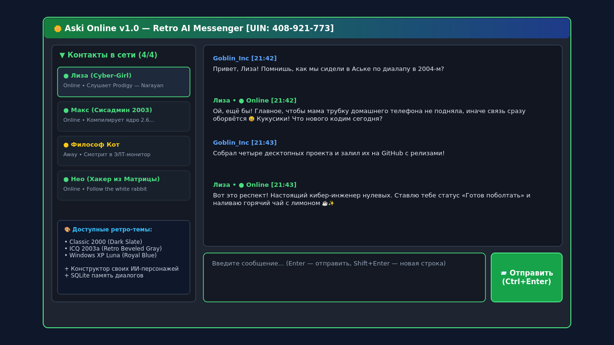

<div align="center">

🌐 **Language:** **English** | [Русский (README_Ru.md)](README_Ru.md)

# 💬 Aski Online (`Aski-Online`)

**Nostalgic early-2000s AI messenger (ICQ 2003a / Windows XP / Classic Dark Slate aesthetic) featuring custom AI personas and persistent SQLite conversation memory**

[](https://python.org)
[](https://riverbankcomputing.com/software/pyqt/)
[](https://sqlite.org)
[](https://github.com/Goblin-Inc/Aski-Online/releases)

<br/>



</div>

---

## 📖 Overview

**Aski Online** is a desktop AI messenger that blends the cozy vibe of Web 1.0 / early-2000s instant messengers with modern Large Language Models (LLMs).

Instead of a sterile web chat, you get a classic contact list with `Online` status indicators, retro badges, customizable AI personalities, and complete local chat history stored in SQLite.

### ✨ Key Features
- **3 Authentic Retro Themes (hot-swappable on the fly)**:
  - 🌑 **Classic 2000 (Dark Slate)** — deep dark-slate UI with neon-green status indicators and retro panels.
  - 🪟 **ICQ 2003a (Retro Gray)** — classic beveled 3D `Win98/2000` borders (`#D4D0C8`) and classic early-2000s typography.
  - 💙 **Windows XP Luna** — iconic blue-and-silver palette inspired by Windows XP SP2.
- **Built-in & Custom AI Personas**:
  - Preloaded companions: **Aski** *(2000s buddy, old-school gamer & music fan)*, **Neo** *(Matrix hacker & Linux/C++ wizard)*, **Cyber-Cat** *(Sarcastic digital pet)*, **Sage** *(Philosopher & advisor)*.
  - **Persona Creator (`+ New`)**: customize the name, emoji avatar, short title, and detailed system prompt (personality, speaking style, lore).
- **Persistent SQLite Memory (`aski_memory.db`)**:
  - Every persona remembers your conversation history across application restarts.
  - Clear individual chat histories or delete custom contacts at any time.
- **Non-Blocking Async AI Engine**: responses are generated in a dedicated `AIWorker (QThread)` with a live *"typing..."* indicator in the status bar.

---

## 🏗️ Project Architecture

```
Aski-Online/
├── main.py              # Entry point, theme initialization, and PyQt6 main window launch
├── ui_main.py           # Main messenger window, contact list, chat view, and persona creation dialog
├── styles.py            # 3 complete QSS themes (Classic 2000 Dark Slate, ICQ 2003a, Windows XP Luna)
├── ai_worker.py         # Non-blocking QThread worker for LLM requests with conversation context
├── database.py          # SQLite manager for personas, settings, and message history (aski_memory.db)
└── requirements.txt     # Dependencies (PyQt6, g4f / requests)
```

---

## 📦 Installation & Usage

### Option 1: Install from `.deb` package (Ubuntu / Debian / KDE Neon)
Download `aski-online_1.0.0_amd64.deb` from [**Releases**](https://github.com/Goblin-Inc/Aski-Online/releases):

```bash
sudo dpkg -i aski-online_1.0.0_amd64.deb
sudo apt-get install -f
```
Launch **Aski Online** from your application menu or by running `aski-online` in the terminal.

### Option 2: Arch Linux (`pacman`) / Run from Source
```bash
git clone https://github.com/Goblin-Inc/Aski-Online.git
cd Aski-Online

# Arch Linux:
sudo pacman -S python python-pyqt6 python-requests
python3 main.py

# Or via the universal installer script (Arch / Ubuntu):
./install.sh
```

---

## 📋 Changelog

### `v1.0.0` — Retro AI Messenger Release *(Current)*
- **Added**: Contact list with built-in AI personas (`Aski`, `Neo`, `Cyber-Cat`, `Sage`) and a custom persona builder.
- **Added**: Local SQLite database (`aski_memory.db`) for persistent chat history and dialogue context.
- **Added**: 3 switchable retro themes (`Classic 2000`, `ICQ 2003a`, `Windows XP Luna`).
- **Added**: Official `.deb` installer and portable archive in GitHub Releases.

---

<div align="center">
Developed by <a href="https://github.com/Goblin-Inc">@Goblin-Inc</a> • <a href="README_Ru.md">Русская версия</a>
</div>

## 📄 License
MIT © [Goblin-Inc](https://github.com/Goblin-Inc)
