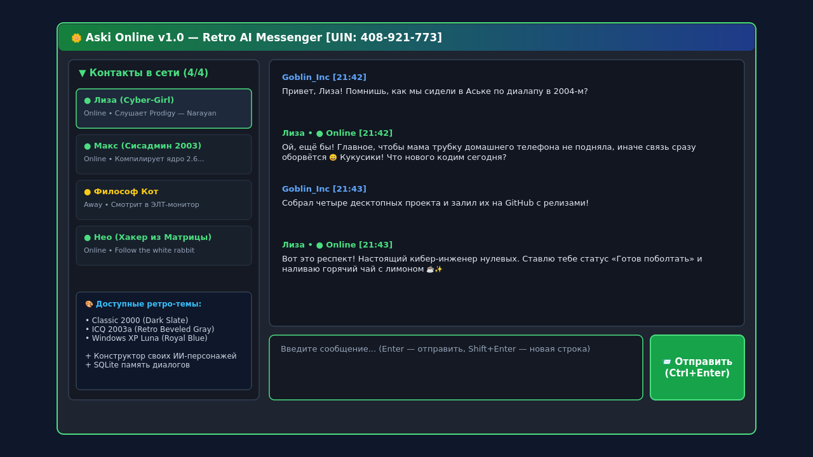

<div align="center">

🌐 **Язык:** [English (README.md)](README.md) | **Русский**

# 💬 Aski Online (`Aski-Online`)

**Ностальгический AI-мессенджер в эстетике десктопных клиентов начала 2000-х (ICQ 2003a / Windows XP / Classic Dark Slate) с кастомными AI-персонажами и долгосрочной памятью диалогов**

[](https://python.org)
[](https://riverbankcomputing.com/software/pyqt/)
[](https://sqlite.org)
[](https://github.com/Goblin-Inc/Aski-Online/releases)

<br/>



</div>

---

## 📖 О проекте

**Aski Online** — десктопный AI-мессенджер, объединяющий ламповую атмосферу интернет-пейджеров эпохи Web 1.0 / начала 2000-х с современными большими языковыми моделями (LLM).

Вместо безликого веб-чата вы получаете классический контакт-лист с индикаторами статуса (`Online`), ретро-бейджами, кастомными характерами собеседников и полной локальной историей переписки в SQLite.

### ✨ Ключевые возможности
- **3 аутентичные темы оформления (переключение на лету)**:
  - 🌑 **Classic 2000 (Dark Slate)** — глубокий тёмно-сланцевый интерфейс с неоново-зелёными индикаторами и ретро-панелями.
  - 🪟 **ICQ 2003a (Retro Gray)** — классические 3D-рамки `Win98/2000` (`#D4D0C8`) и фирменные шрифты эпохи раннего Рунета.
  - 💙 **Windows XP Luna** — сине-серебристая палитра в стиле эпохи Windows XP SP2.
- **Готовые и пользовательские AI-персонажи (Personas)**:
  - Встроенные собеседники: **Аски** *(Друг из 2000-х, олдскульный геймер и меломан)*, **Нео** *(Хакер из Матрицы и эксперт по Linux/C++)*, **Кибер-Кот** *(Саркастичный цифровой питомец)*, **Мудрец** *(Философ и советчик)*.
  - **Конструктор персонажей (`+ Новый`)**: задайте имя, аватар-эмодзи, краткий титул и детальный системный промпт (характер, манеру речи, лор).
- **Персистентная память в SQLite (`aski_memory.db`)**:
  - Каждый персонаж помнит контекст вашей переписки между перезапусками программы.
  - Возможность очистки истории конкретного чата или удаления кастомного контакта.
- **Асинхронный AI-движок без зависаний GUI**: генерация ответов выполняется в выделенном потоке `AIWorker (QThread)` с индикатором *«печатает...»* в статус-баре.

---

## 🏗️ Архитектура проекта

```
Aski-Online/
├── main.py              # Точка входа, инициализация темы и запуск главного окна PyQt6
├── ui_main.py           # Главное окно мессенджера, контакт-лист, окно чата и диалог создания персонажа
├── styles.py            # 3 полных QSS-стиля (Classic 2000 Dark Slate, ICQ 2003a, Windows XP Luna)
├── ai_worker.py         # QThread-воркер для неблокирующих запросов к LLM с передачей истории контекста
├── database.py          # SQLite-менеджер персонажей, настроек и истории сообщений (aski_memory.db)
└── requirements.txt     # Зависимости (PyQt6, g4f / requests)
```

---

## 📦 Установка и запуск

### Вариант 1: Установка из `.deb` пакета (Ubuntu / Debian / KDE Neon)
Скачайте `aski-online_1.0.0_amd64.deb` со страницы [**Releases**](https://github.com/Goblin-Inc/Aski-Online/releases):

```bash
sudo dpkg -i aski-online_1.0.0_amd64.deb
sudo apt-get install -f
```
Запустите **Aski Online** из меню приложений или командой `aski-online` в терминале.

### Вариант 2: Arch Linux (`pacman`) / Запуск из исходников
```bash
git clone https://github.com/Goblin-Inc/Aski-Online.git
cd Aski-Online

# Arch Linux:
sudo pacman -S python python-pyqt6 python-requests
python3 main.py

# Либо через универсальный скрипт (Arch / Ubuntu):
./install.sh
```

---

## 📋 Changelog

### `v1.0.0` — Релиз ретро AI-мессенджера *(Текущая версия)*
- **Добавлено**: Контакт-лист со встроенными AI-персонажами (`Аски`, `Нео`, `Кибер-Кот`, `Мудрец`) и редактор собственных персонажей.
- **Добавлено**: Локальная база данных SQLite (`aski_memory.db`) для сохранения истории сообщений и контекста диалога.
- **Добавлено**: 3 сменные ретро-темы (`Classic 2000`, `ICQ 2003a`, `Windows XP Luna`).
- **Добавлено**: Готовый `.deb` установщик и portable-архив в GitHub Releases.

---

<div align="center">
Разработано <a href="https://github.com/Goblin-Inc">@Goblin-Inc</a>
</div>
